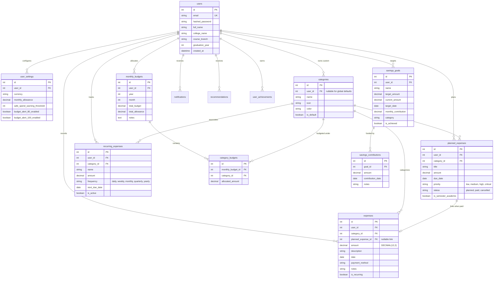

# Ledger. — Intelligent Student Expense Analytics & Budgeting Platform
> **Student Financial OS** • Neo-Fintech Editorial Personal Finance for College Life

[](https://python.org)
[](https://fastapi.tiangolo.com)
[](https://react.dev)
[](https://www.typescriptlang.org)
[](https://vitejs.dev)
[](https://tailwindcss.com)
[](LICENSE)

---

## 1. Executive Product Overview

**Ledger.** is an intelligent, full-stack student financial operating system built specifically for college students. Unlike generic personal finance trackers or superficial mockups, Ledger addresses the unique realities of student cash flow: irregular pocket money and allowances, academic semester fee spikes (exam fees, textbooks, hardware kits), hostel rent, subscription overhead, and fluctuating canteen expenses.

### Key Philosophy
* **Neo-Fintech Editorial Aesthetic**: Grounded in Warm Canvas (`#F7F7F2`), Forest Ledger (`#163D32`), Electric Lime (`#D8FF65`), and Ink (`#252A27`). Editorial, trustworthy, data-dense, without childish gamification or fake crypto visual noise.
* **Deterministic, Explainable Intelligence**: Transparent mathematical calculations and rule-based insights. No deceptive "black-box AI" claims for basic arithmetic.
* **Student-Specific Workflows**:
  * **Safe-to-Spend Daily Allowance**: Accounts for unspent monthly funds after subtracting reserved upcoming academic commitments.
  * **Smart Overspending Predictor**: Estimates month-end expenditure pace versus configured budget.
  * **Semester Expense Planner**: Coordinates exam fees, projects, and books with a single-click "Mark Paid" flow that converts commitments into linked expenses without double counting.
  * **Natural-Language Expense Entry**: Deterministically parses inputs like *"Spent ₹180 on college stationery notebook today"* into structured amount, category, date, and description fields with full user confirmation.
  * **What-If Budget Simulator**: Interactive category sliders to evaluate reallocation impact in real time before committing changes.
  * **Interactive Analytics & Spending Calendar**: Area charts, donut distribution, month-over-month variances, and daily heatmaps.
  * **Deterministic Analytical Assistant**: Answers queries like *"What is my safe to spend today?"* and *"How much did I spend on food this month?"* directly from database records.

---

## 2. System Architecture

```
┌────────────────────────────────────────────────────────────────────────┐
│                          LEDGER FRONTEND                               │
│  React 19 + TypeScript + Vite + Tailwind CSS + Recharts + Lucide Icons │
│                                                                        │
│  [Landing] [Dashboard] [Transactions] [Budgets] [Analytics]            │
│  [Semester Planner] [Savings Goals] [Subscriptions] [Simulator]        │
│  [Calendar] [Financial Health] [Assistant] [Reports & CSV Export]      │
└───────────────────────────────────┬────────────────────────────────────┘
                                    │ REST API / JWT Bearer
                                    ▼
┌────────────────────────────────────────────────────────────────────────┐
│                          LEDGER BACKEND                                │
│       FastAPI (Python 3.10+) + Pydantic v2 + SQLAlchemy ORM            │
│                                                                        │
│  ├── /api/auth       (Registration, Login, User Settings, 1-Click Demo)│
│  ├── /api/expenses   (CRUD, Filter, Search, Sort, Stats)               │
│  ├── /api/budgets    (Monthly & Category Budgets, Utilization)         │
│  ├── /api/analytics  (Trends, Distributions, MoM Change, Calendar)     │
│  ├── /api/insights   (Deterministic Financial Recommendations)         │
│  ├── /api/planning   (Semester Commitments, Savings Goals, Recurring)  │
│  ├── /api/assistant  (Deterministic Analytical Q&A, Natural NLP Parser)│
│  └── /api/reports    (Summary Aggregations, Streaming CSV Export)      │
└───────────────────────────────────┬────────────────────────────────────┘
                                    │ SQLAlchemy Engine
                                    ▼
┌────────────────────────────────────────────────────────────────────────┐
│                   RELATIONAL DATABASE (ACID COMPLIANT)                 │
│  SQLite (Zero-config local dev) / MySQL 8.0+ (Production relational)   │
│  Managed via Alembic Schema Migrations                                 │
└────────────────────────────────────────────────────────────────────────┘
```

---

## 3. Database Schema & Entity Relationship Diagram (ERD)

The database uses a normalized 13-table schema with strict foreign keys, cascade safety, and decimal-safe storage (`DECIMAL(12, 2)` / Python `Decimal`) to eliminate floating-point precision errors.



---

## 4. Financial Calculation Engine & Rules

The application implements mathematical definitions designed specifically for student finances:

### A. Daily Safe-to-Spend Formula
```
Safe-to-Spend per Day = (Remaining Usable Funds - Reserved Upcoming Commitments) / Days Remaining in Month
```
* **Remaining Usable Funds**: `Monthly Allowance - Month-to-Date Recorded Expenses`.
* **Reserved Upcoming Commitments**: Sum of uncompleted `planned_expenses` due within the remaining days of the current month.
* **Edge Case Handling**: If commitments exceed remaining funds, the system clamps the allowance at ₹0.00 and raises an actionable deficit notice rather than showing misleading negative values.

### B. Month-End Overspending Predictor
```
Projected Month-End Spend = (Month-to-Date Spending / Elapsed Days) × Total Days in Month
Projected Variance = Projected Month-End Spend - Configured Monthly Budget
```
* Accounts for leap years and dynamic month lengths (28, 29, 30, 31 days).
* Displays explicit confidence ratings (e.g. `Low Data` on Day 1-3 vs `High Data` on Day 15+).

### C. Academic Planned Expense Linkage (No Double Counting)
When a student clicks **"Mark Paid"** on an academic planned expense (e.g., *End-Term Exam Registration Fee, ₹2,400*):
1. The status of the planned expense transitions from `planned` to `paid`.
2. A linked `Expense` transaction is automatically generated with `planned_expense_id = planned.id`.
3. The reserved planned commitments bucket is decremented by ₹2,400, and the recorded expenses bucket is incremented by ₹2,400 in a single database transaction. This prevents double counting in the Safe-to-Spend calculator.

### D. What-If Budget Simulator
Allows real-time modification of category budget ceilings. Calculates:
* Revised simulated monthly spend.
* Expected net monthly savings surplus.
* Recalculated Safe-to-Spend per day.
* One-click commitment to update the official monthly budget.

---

## 5. Quick Start & Setup Instructions

### Prerequisites
* **Python 3.10+** (tested on Python 3.10, 3.11, 3.12, 3.14)
* **Node.js 18+** & **npm**

---

### Step 1: Backend Setup

```bash
cd backend

# Create and activate virtual environment
# Windows:
python -m venv venv
.\venv\Scripts\activate

# macOS / Linux:
# python3 -m venv venv
# source venv/bin/activate

# Install dependencies
pip install -r requirements.txt

# Configure environment variables
# Copy .env.example to .env (configured by default for SQLite out of the box)
copy .env.example .env

# Run database migrations using Alembic
alembic upgrade head

# Seed synthetic student demo data (Aarav Sharma - DTU Campus)
python -m app.seed.demo_data

# Start the FastAPI backend server
uvicorn app.main:app --host 127.0.0.1 --port 8000 --reload
```

The backend API will be available at: `http://127.0.0.1:8000`  
Swagger Interactive API Documentation: `http://127.0.0.1:8000/docs`

---

### Step 2: Running Backend Tests

In a separate terminal (with the virtual environment activated):

```bash
cd backend
# Windows PowerShell:
$env:PYTHONPATH="."
.\venv\Scripts\pytest -v

# macOS / Linux:
# export PYTHONPATH="."
# pytest -v
```

All 9 unit & API tests will execute and pass:
* `tests/test_api.py::test_health_check`
* `tests/test_api.py::test_register_and_login`
* `tests/test_api.py::test_quick_demo_login`
* `tests/test_calculations.py::test_month_days_calculation`
* `tests/test_calculations.py::test_safe_to_spend_and_overrun`
* `tests/test_calculations.py::test_financial_health_score`
* `tests/test_nlp_parser.py::test_nlp_parser_lunch`
* `tests/test_nlp_parser.py::test_nlp_parser_books`
* `tests/test_nlp_parser.py::test_nlp_parser_invalid`

---

### Step 3: Frontend Setup

```bash
cd frontend

# Install npm dependencies
npm install

# Run production build check (TypeScript & Vite)
npm run build

# Start local development server
npm run dev
```

The frontend application will be available at: `http://127.0.0.1:5173`

---

### Step 4: Optional MySQL Production Configuration

To switch from SQLite to MySQL:
1. Create a MySQL database:
   ```sql
   CREATE DATABASE ledger_db CHARACTER SET utf8mb4 COLLATE utf8mb4_unicode_ci;
   ```
2. Update `backend/.env`:
   ```ini
   DATABASE_URL=mysql+pymysql://<user>:<password>@<host>:3306/ledger_db
   ```
3. Run Alembic migrations and seed data:
   ```bash
   alembic upgrade head
   python -m app.seed.demo_data
   ```

---

## 6. Synthetic Demonstration Account

The repository includes a multi-month synthetic student profile created for presentation:

| Credential | Value |
|---|---|
| **Student Name** | Aarav Sharma |
| **Institution** | Delhi Technological University (DTU) |
| **Course** | B.Tech Computer Engineering (Semester 5) |
| **Email** | `aarav.student@ledger.app` |
| **Password** | `Password@123` |
| **1-Click Demo Login** | Accessible on the Landing Page and Login Page |

### What is Included in the Demo Data:
* **Historical Multi-Month Transactions**: Realistic transactions across Food, Campus Canteen, Metro Recharges, Books, Cloud Certifications, Room rent, and Subscriptions for August, September, and October 2026.
* **Configured Budgets**: Monthly allowance of ₹18,000, category budgets across all 10 core student verticals.
* **Academic Commitments**: End-term exam fees, semester project kits, textbooks.
* **Savings Targets**: Laptop fund, Hackathon travel fund.
* **Subscriptions**: Spotify Student, Mobile Data Recharge, GitHub Pro.
* **Insights & Alerts**: Category variance alerts, overspending warnings, safe-to-spend benchmarks.

---

## 7. API Reference Overview

| Domain | Method | Endpoint | Description |
|---|---|---|---|
| **Health** | `GET` | `/api/health` | Service health status |
| **Auth** | `POST` | `/api/auth/register` | Register new student profile |
| **Auth** | `POST` | `/api/auth/login` | Authenticate and obtain JWT bearer token |
| **Auth** | `POST` | `/api/auth/quick-demo-login` | 1-Click synthetic student login |
| **Auth** | `GET` | `/api/auth/me` | Fetch authenticated user profile & settings |
| **Auth** | `PUT` | `/api/auth/settings` | Update currency, allowance, and alert thresholds |
| **Expenses** | `GET` | `/api/expenses/` | List, filter by category/date, search, sort |
| **Expenses** | `POST` | `/api/expenses/` | Record new transaction |
| **Expenses** | `PUT` | `/api/expenses/{id}` | Update existing transaction |
| **Expenses** | `DELETE`| `/api/expenses/{id}` | Delete transaction |
| **Budgets** | `GET` | `/api/budgets/` | Get monthly budget with category utilization |
| **Budgets** | `POST` | `/api/budgets/` | Upsert monthly and category budgets |
| **Analytics**| `GET` | `/api/analytics/dashboard` | Aggregated KPI figures, trends, donut charts |
| **Analytics**| `GET` | `/api/analytics/trends` | Multi-month spending trend series |
| **Analytics**| `GET` | `/api/analytics/calendar` | Day-by-day spending heatmap |
| **Analytics**| `GET` | `/api/analytics/health-score`| 0-100 student financial health indicator |
| **Insights** | `GET` | `/api/insights/` | Rule-based recommendations with impact & actions |
| **Insights** | `PUT` | `/api/insights/{id}/status`| Review or dismiss insight |
| **Planning** | `GET` | `/api/planning/planned-expenses` | List semester commitments |
| **Planning** | `POST`| `/api/planning/planned-expenses/{id}/mark-paid` | Convert commitment to linked expense |
| **Planning** | `GET` | `/api/planning/savings-goals` | Track savings targets & milestones |
| **Planning** | `POST`| `/api/planning/savings-goals/{id}/contribute` | Add funds to a savings goal |
| **Planning** | `GET` | `/api/planning/subscriptions` | View active subscriptions & annual costs |
| **Simulator**| `POST`| `/api/insights/simulator` | Compute what-if adjustments |
| **Assistant**| `POST`| `/api/assistant/ask` | Deterministic analytical financial Q&A |
| **Assistant**| `POST`| `/api/assistant/parse-nlp` | Parse natural-language expense sentence |
| **Reports**  | `GET` | `/api/reports/summary` | Consolidated monthly financial report |
| **Reports**  | `GET` | `/api/reports/export-csv` | Download filtered expense records as CSV |

---

## 8. Verification & Deliverables Summary

| Requirement Area | Status | Implementation Details |
|---|---|---|
| **A. Landing Page** | Completed | Clean editorial presentation, core propositions, live demo action |
| **B. Authentication** | Completed | Secure Argon2/bcrypt password hashing, JWT authorization, protected routes |
| **C. Main Dashboard** | Completed | 15 required sections, balance vs budget, safe-to-spend, charts |
| **D. Expense Management** | Completed | Full CRUD, search, category filter, date range, pagination, Indian formatting |
| **E. Student Budget Planner** | Completed | 10 default student categories, custom category support, utilization bars |
| **F. Expense Analytics** | Completed | Area trends, category distribution donut, budget vs actual bars |
| **G. Smart Insights** | Completed | Explainable rule-based engine: Detection, Magnitude, Recommended Move |
| **H. Budget Alerts** | Completed | 80% & 100% threshold detection, recurring expense notifications |
| **I. Semester Planner** | Completed | Academic commitments, exam fees, 1-click "Mark Paid" without double count |
| **J. Savings Goals** | Completed | Target tracking, progress percentages, milestone badges, contribution modal |
| **K. Subscription Tracker**| Completed | Billing cycle tracking, annual overhead calculations |
| **L. Safe-to-Spend Calc** | Completed | `(Remaining - Reserved) / Days Left` formula with transparent breakdown |
| **M. Overspending Predictor**| Completed | Elapsed-day extrapolation with data confidence indicators |
| **N. What-If Simulator** | Completed | Interactive category sliders, live savings recalculated, 1-click apply |
| **O. Spending Calendar** | Completed | Daily intensity heatmap with transaction day inspector |
| **P. Habit Challenges** | Completed | Positive financial milestones, engagement achievements |
| **Q. Natural Entry (NLP)** | Completed | Deterministic parsing ("Spent ₹180 on books today") + confirmation preview |
| **R. Financial Health** | Completed | 0–100 score evaluating adherence, recording consistency, and goal pace |
| **S. Ask Expenses Assistant**| Completed | Deterministic analytical Q&A over authenticated student data |
| **T. Reports & Exports** | Completed | Printable monthly financial statement, filtered CSV download |

---

## 9. Design System Guidelines
* **Canvas Background**: `#F7F7F2` (Warm Canvas)
* **Primary Brand**: `#163D32` (Forest Ledger)
* **Accent Highlight**: `#D8FF65` (Electric Lime)
* **Warning & Alerts**: `#B95D43` (Terracotta)
* **Card Surface**: `#FFFFFF` (Paper White)
* **Text Ink**: `#252A27` (Deep Ink)
* **Subtle Borders**: `#E5E5DF`

---

## 10. License
Developed for college mini project demonstration. Released under the MIT License.
