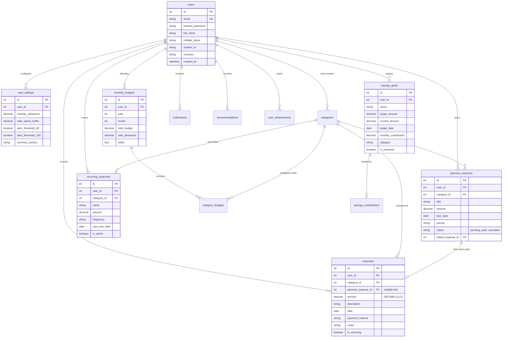

# CampusTech — Student Financial Intelligence
> **Your money, your semester, your perspective.** • Neo-Fintech Editorial Personal Finance for College Life

[](https://python.org)
[](https://fastapi.tiangolo.com)
[](https://react.dev)
[](https://www.typescriptlang.org)
[](https://vitejs.dev)
[](https://tailwindcss.com)
[](LICENSE)

---

## 1. Executive Product Overview

**CampusTech** is an intelligent, full-stack student financial intelligence platform engineered specifically for college students. Unlike generic personal finance trackers or static mockups, CampusTech addresses the unique cash flow dynamics of student life: irregular pocket money and allowances, semester fee spikes (exam registrations, hardware prototype kits, textbooks), accommodation rent, subscription overhead, and canteen spending.

### Core Architecture & Privacy Principles
* **Neo-Fintech Editorial Visual Identity**: Clean typography, consistent 8px-grid spacing, thin borders, and restrained Electric Lime accents.
* **Complete Light / Dark / System Theme Engine**:
  * **Light Mode**: Warm Canvas (`#F7F7F2`), Paper White (`#FFFFFF`), Forest Brand (`#163D32`), Ink text (`#252A27`).
  * **Dark Mode**: Refined deep charcoal/green canvas (`#0F1412`), dark card surfaces (`#161D1A`), high-contrast text (`#EFF2EE`), subtle borders (`#242E28`), and lime highlights (`#D8FF65`).
  * **System Mode**: Automatically synchronizes with operating system preferences via `prefers-color-scheme`.
  * **Zero Theme Flashing**: Inline script in `<head>` applies active theme before DOM paint.
* **Public Homepage Data Privacy**: The public landing page renders zero personal user names, colleges, allowances, or database records. Instead, it features an editorial product presentation with generic conceptual previews labeled `"Illustrative preview — sample synthetic model"`.
* **Strict Backend Authorization & User Isolation**:
  * Every financial resource endpoint checks verified JWT claims.
  * User A cannot read, update, or delete User B's transactions, budgets, or savings goals.
  * Fresh/empty accounts display helpful empty states with zero fabricated figures.
* **Deterministic, Explainable Financial Intelligence**: Transparent mathematical formulas without deceptive "black-box AI" claims for basic arithmetic.

---

## 2. System Architecture

```
┌────────────────────────────────────────────────────────────────────────┐
│                        CAMPUSTECH FRONTEND                             │
│  React 19 + TypeScript + Vite + Tailwind CSS + Recharts + Lucide Icons │
│                                                                        │
│  [Theme Selector: Light / Dark / System]                               │
│  [Public Landing] [Sign In] [Register]                                 │
│  [Protected App Workspace]:                                            │
│    ├── Overview Dashboard (15 Financial Modules)                       │
│    ├── Transactions (Full CRUD, Search, Filter, Sort)                  │
│    ├── Student Budget Planner (Category Ceilings & Utilization)        │
│    ├── Expense Analytics (Theme-aware Recharts, Trend, Donut, MoM)     │
│    ├── Smart Insights (Explainable Detections & Actions)               │
│    ├── Semester Planner (Academic Fees, Mark Paid linkage)             │
│    ├── Savings Goals (Targets, Contributions, Badges)                  │
│    ├── Subscriptions (Equivalent Annual Costs & Allowance Overhead)    │
│    ├── What-If Simulator (Interactive Real-time Adjustment Sliders)   │
│    ├── Spending Calendar (Heatmap Intensity & Day Inspector)           │
│    ├── Financial Health Indicator & Habit Badges                       │
│    ├── Ask Your Expenses Assistant (Deterministic Analytical Q&A)      │
│    ├── Reports & Statements (Printable PDF View & CSV Export)          │
│    └── Preferences & Settings (Allowances, Alert Thresholds, Themes)   │
└───────────────────────────────────┬────────────────────────────────────┘
                                    │ REST API / JWT Bearer
                                    ▼
┌────────────────────────────────────────────────────────────────────────┐
│                        CAMPUSTECH BACKEND                              │
│       FastAPI (Python 3.10+) + Pydantic v2 + SQLAlchemy ORM            │
│                                                                        │
│  ├── /api/auth       (Registration, Login, User Settings, 1-Click Demo)│
│  ├── /api/expenses   (CRUD, Filter, Search, Sort, Stats)               │
│  ├── /api/budgets    (Monthly & Category Budgets, Utilization)         │
│  ├── /api/analytics  (Trends, Distributions, MoM Change, Calendar)     │
│  ├── /api/insights   (Deterministic Financial Recommendations)         │
│  ├── /api/planning   (Semester Commitments, Savings Goals, Recurring)  │
│  ├── /api/assistant  (Deterministic Analytical Q&A, Natural NLP Parser)│
│  └── /api/reports    (Summary Aggregations, Streaming CSV Export)      │
└───────────────────────────────────┬────────────────────────────────────┘
                                    │ SQLAlchemy Engine
                                    ▼
┌────────────────────────────────────────────────────────────────────────┐
│                   RELATIONAL DATABASE (ACID COMPLIANT)                 │
│  SQLite (Zero-config local dev) / MySQL 8.0+ (Production relational)   │
│  Managed via Alembic Schema Migrations                                 │
└────────────────────────────────────────────────────────────────────────┘
```

---

## 3. Database Schema & Entity Relationship Diagram (ERD)

The database uses a normalized schema with strict foreign keys, cascade safety, and decimal-safe storage (`DECIMAL(12, 2)` / Python `Decimal`) to eliminate floating-point precision errors.



---

## 4. Financial Calculation Engine & Rules

### A. Daily Safe-to-Spend Formula
```
Safe-to-Spend per Day = (Remaining Usable Funds - Reserved Upcoming Commitments) / Days Remaining in Month
```
* **Remaining Usable Funds**: `Monthly Allowance - Month-to-Date Recorded Expenses`.
* **Reserved Upcoming Commitments**: Sum of uncompleted `planned_expenses` due within the remaining days of the current month.
* **Deficit Handling**: Clamped at ₹0.00 with actionable warning alerts when commitments exceed available funds.

### B. Month-End Overspending Predictor
```
Projected Month-End Spend = (Month-to-Date Spending / Elapsed Days) × Total Days in Month
Projected Variance = Projected Month-End Spend - Configured Monthly Budget
```
* Accounts for leap years and dynamic month lengths (28, 29, 30, 31 days).
* Displays explicit confidence ratings (e.g. `Low Data` on Day 1-3 vs `High Data` on Day 15+).

### C. Zero Double-Counting Linkage
When a student marks an academic planned expense as paid:
1. Status transitions from `pending` to `paid`.
2. A linked `Expense` transaction is created with `planned_expense_id = planned.id`.
3. The reserved planned commitments bucket is decremented, and recorded expenses is incremented in a single database transaction, ensuring the daily Safe-to-Spend allowance is never reduced twice.

---

## 5. Quick Start & Setup Instructions

### Prerequisites
* **Python 3.10+** (tested with Python 3.10, 3.11, 3.12, 3.14)
* **Node.js 18+** & **npm**

---

### Step 1: Backend Setup

```bash
cd backend

# Create and activate virtual environment
# Windows PowerShell:
python -m venv venv
.\venv\Scripts\activate

# macOS / Linux:
# python3 -m venv venv
# source venv/bin/activate

# Install dependencies
pip install -r requirements.txt

# Seed synthetic student demo records (Aarav Sharma - DTU Campus)
python -m app.seed.demo_data

# Start FastAPI backend server with hot-reload
uvicorn app.main:app --host 127.0.0.1 --port 8000 --reload
```

* Backend API Root: `http://127.0.0.1:8000`
* Swagger Interactive API Docs: `http://127.0.0.1:8000/docs`

---

### Step 2: Running Automated Tests

```bash
cd backend
# Windows PowerShell:
$env:PYTHONPATH="."
.\venv\Scripts\pytest -v

# macOS / Linux:
# export PYTHONPATH="."
# pytest -v
```

All 12 automated unit, API, and security authorization tests will execute and pass:
* `tests/test_api.py::test_health_check`
* `tests/test_api.py::test_register_and_login`
* `tests/test_api.py::test_quick_demo_login`
* `tests/test_authorization.py::test_unauthenticated_access_blocked`
* `tests/test_authorization.py::test_user_data_isolation_cross_user_forbidden`
* `tests/test_authorization.py::test_fresh_account_empty_states_no_invented_figures`
* `tests/test_calculations.py::test_month_days_calculation`
* `tests/test_calculations.py::test_safe_to_spend_and_overrun`
* `tests/test_calculations.py::test_financial_health_score`
* `tests/test_nlp_parser.py::test_nlp_parser_lunch`
* `tests/test_nlp_parser.py::test_nlp_parser_books`
* `tests/test_nlp_parser.py::test_nlp_parser_invalid`

---

### Step 3: Frontend Setup

```bash
cd frontend

# Install npm dependencies
npm install

# Production build check (TypeScript & Vite)
npm run build

# Start local development server
npm run dev
```

* Frontend Application URL: `http://127.0.0.1:5173`

---

## 6. Synthetic Demonstration Account

| Credential | Value |
|---|---|
| **Student Name** | Aarav Sharma |
| **Institution** | Delhi Technological University (DTU) |
| **Course** | B.Tech Computer Engineering (Semester 5) |
| **Email** | `demo.student@campustech.app` |
| **Password** | `Password@123` |
| **1-Click Demo Login** | Accessible on the Landing Page and Login Page |

---

## 7. API Reference Overview

| Domain | Method | Endpoint | Description |
|---|---|---|---|
| **Health** | `GET` | `/api/health` | Service health status (`campustech-api`) |
| **Auth** | `POST` | `/api/auth/register` | Register new student profile |
| **Auth** | `POST` | `/api/auth/login` | Authenticate and obtain JWT bearer token |
| **Auth** | `POST` | `/api/auth/logout` | Terminate session |
| **Auth** | `POST` | `/api/seed/quick-demo-login` | 1-Click synthetic student login |
| **Auth** | `GET` | `/api/auth/me` | Fetch authenticated user profile & settings |
| **Auth** | `PUT` | `/api/auth/settings` | Update currency, allowance, and alert thresholds |
| **Expenses** | `GET` | `/api/expenses` | List, filter by category/date, search, sort |
| **Expenses** | `POST` | `/api/expenses` | Record new transaction |
| **Expenses** | `GET` | `/api/expenses/{id}` | Retrieve expense (user-isolated) |
| **Expenses** | `PUT` | `/api/expenses/{id}` | Update existing transaction |
| **Expenses** | `DELETE`| `/api/expenses/{id}` | Delete transaction |
| **Budgets** | `GET` | `/api/budgets` | Get monthly budget with category utilization |
| **Budgets** | `POST` | `/api/budgets` | Upsert monthly and category budgets |
| **Analytics**| `GET` | `/api/analytics/dashboard` | Aggregated KPI figures, trends, donut charts |
| **Analytics**| `GET` | `/api/analytics/trend` | Multi-month spending trend series |
| **Analytics**| `GET` | `/api/analytics/calendar` | Day-by-day spending heatmap |
| **Analytics**| `GET` | `/api/analytics/health` | 0-100 student financial health indicator |
| **Insights** | `GET` | `/api/insights` | Rule-based recommendations with impact & actions |
| **Planning** | `GET` | `/api/planning/semester` | List semester commitments |
| **Planning** | `POST`| `/api/planning/semester/{id}/pay` | Convert commitment to linked expense |
| **Planning** | `GET` | `/api/planning/savings-goals` | Track savings targets & milestones |
| **Planning** | `GET` | `/api/planning/subscriptions` | View active subscriptions & annual costs |
| **Assistant**| `POST`| `/api/assistant/ask` | Deterministic analytical financial Q&A |
| **Assistant**| `POST`| `/api/assistant/parse-nlp` | Parse natural-language expense sentence |
| **Reports**  | `GET` | `/api/reports/summary` | Consolidated monthly financial report |
| **Reports**  | `GET` | `/api/reports/csv` | Download filtered expense records as CSV |

---

## 8. License
Developed for college mini project demonstration. Released under the MIT License.
